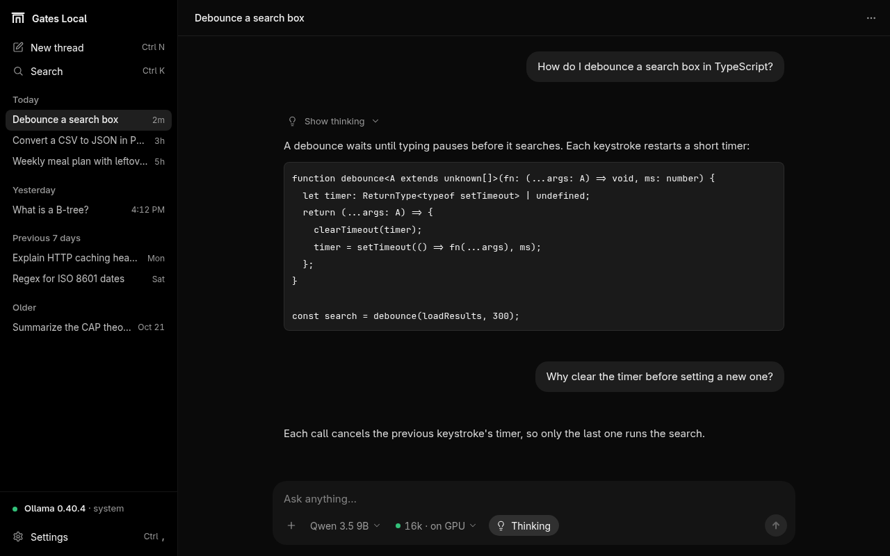
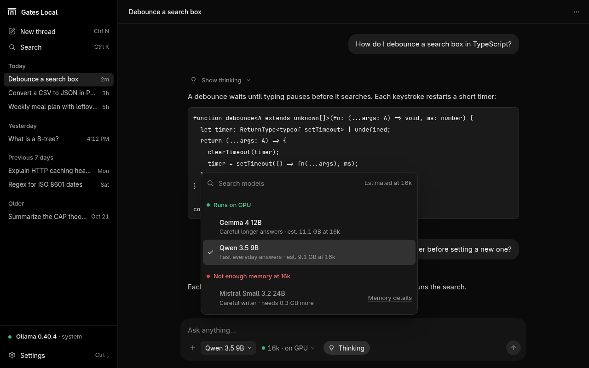
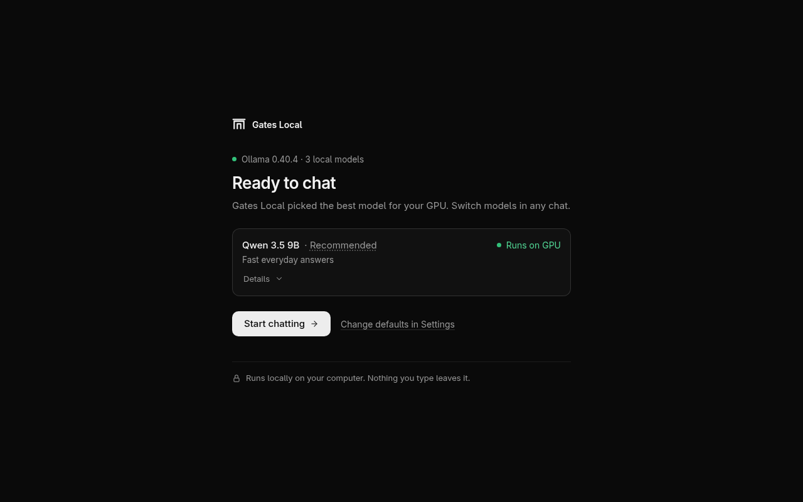
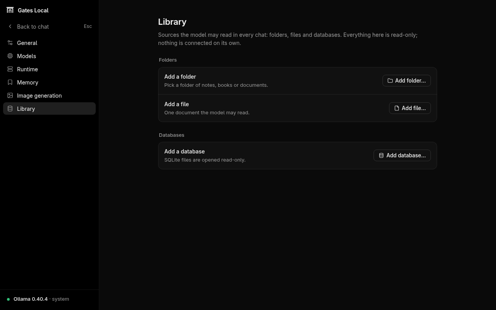
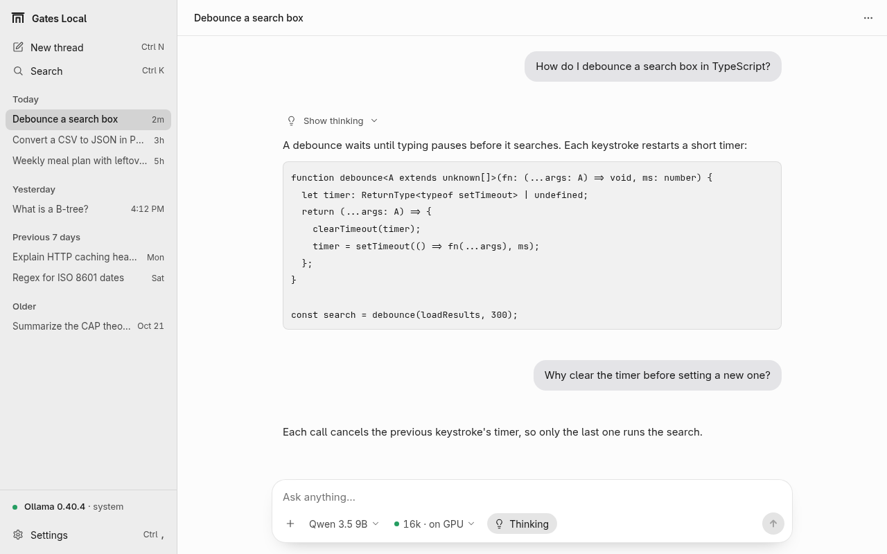

# Gates Local

A desktop chat app for running AI models on your own Linux or Windows machine through
Ollama, for people who want local models without guessing whether they fit.



## What it does

- Uses the Ollama you already run. If none answers, it starts its own copy
  on its own port. It never stops an Ollama it did not start.
- Checks memory before a model loads. Each model gets a label for the
  chosen context size: runs on GPU, uses system memory (slower), or not
  enough memory.
- Uses a 16k context by default and never less, with 32k and 64k as
  options.
- Streams replies, shows the model's thinking, and has Stop and Retry.
  Threads are saved in a local SQLite file and survive a server restart.
- Downloads models from a short list inside the app, with progress and
  cancel.
- Library: connect folders, files or SQLite databases for the model's
  tools to read. The app never writes to them. A database is read from a
  private copy taken when you connect it, and again when you press
  Refresh. A file or folder is read as it is now, so later changes are
  visible. On Linux the shell tool runs in a bubblewrap sandbox with no
  network.
- Optional image generation through ComfyUI. It is off until you turn it
  on.
- Dark and light themes. It follows your system setting until you pick one.

<table>
  <tr>
    <td width="50%"></td>
    <td width="50%"></td>
  </tr>
  <tr>
    <td>The model picker labels each installed model for the chosen context.</td>
    <td>First run finds Ollama and picks an installed model that fits.</td>
  </tr>
  <tr>
    <td></td>
    <td></td>
  </tr>
  <tr>
    <td>Library sources are added in Settings. None are connected by default.</td>
    <td>The light theme.</td>
  </tr>
</table>

## Requirements

- **OS:** Linux on x64, in a graphical desktop session (X11 or Wayland),
  or Windows 11 on x64. Windows has been tested on one machine without an
  NVIDIA GPU; see [docs/setup/windows.md](docs/setup/windows.md).
- **Node.js** 24 or newer.
- **pnpm** 11.10.0. Corepack picks this version from `package.json`. On
  Windows, install it with `npm install -g pnpm@11.10.0` instead.
- **Ollama.** Install it from <https://ollama.com/download>. If Ollama is
  not on your machine, the app tries to download a pinned Ollama release
  from GitHub on first launch (Linux x64 and Windows x64). On Linux that
  path has not been tested on a real machine yet, so installing Ollama
  yourself is the safer route there. On Windows it was tested on one
  machine.
- **GPU:**
  - *NVIDIA:* the app reads free GPU memory with `nvidia-smi` and plans the
    model around it. If `nvidia-smi` is installed but fails, the app
    refuses to start a chat and says why.
  - *Other GPUs (AMD, Intel, Apple):* the app does not read their memory. It
    plans as if there were no GPU, so the labels are cautious. Ollama may
    still use the GPU when it loads the model.
  - *No GPU:* the app plans the whole model in system memory and labels it
    "Uses system memory · slower". Replies will be slow on larger models.
- **Shell tool (optional):** an x86_64 or aarch64 CPU, bubblewrap at
  `/usr/bin/bwrap`, working unprivileged user namespaces, and a systemd
  user session that can start scopes with memory and task limits. Without
  them the shell tool is off and the read tool still works. On Linux,
  queries on a connected database go through this tool and also need
  `sqlite3` at `/usr/bin/sqlite3`.
- **ComfyUI (optional):** only for image generation. See
  [docs/setup/linux.md](docs/setup/linux.md#4-optional-image-generation-with-comfyui).

## Quick start on Linux

Install Ollama and start it first. Then:

```sh
git clone https://github.com/Calculator5329/gates-local.git
cd gates-local
corepack enable pnpm
pnpm install
pnpm start
```

`pnpm start` builds the app and opens its window. On first run it finds
Ollama and lists your models. With no models installed, it offers some to
download. On Ubuntu 23.10 and later, Electron may stop with "No usable
sandbox!" until you add an AppArmor profile; the guide shows how. The
window has no menu bar: Ctrl+R reloads, Ctrl+W closes, Ctrl+Q quits and F11
goes full screen while it has focus. The full guide, with the other keys,
adding the app to your app list, updating, uninstalling and fixes for
common problems, is [docs/setup/linux.md](docs/setup/linux.md).

## Quick start on Windows

Install Node.js 24 from <https://nodejs.org>, Git, and Ollama with the
official installer from <https://ollama.com/download>, and start Ollama.
Then, in PowerShell:

```powershell
npm install -g pnpm@11.10.0
git clone https://github.com/Calculator5329/gates-local.git
cd gates-local
pnpm install
pnpm start
```

Nothing here needs administrator rights. Without an NVIDIA GPU, models run
in system memory on the CPU and replies are slower; turning Thinking off
helps. The shell tool is off on Windows. The full guide, with data folders,
measured speeds, updating and uninstalling, is
[docs/setup/windows.md](docs/setup/windows.md).

## Updating

In the app, Settings › General › Updates shows the version and has a
"Check for updates" button. It checks only when you click it. In the desktop
app, "Update and restart" closes the window, installs the new version and
opens the app again. The next start shows how it went. On a phone or in a
browser you see the version and the check, and install from the computer
the app runs on.

A copy from before this button existed has to update once by hand. Close
Gates Local, then run this in its folder:

```sh
git pull
pnpm install
pnpm start
```

That path keeps working. So does the same update from a terminal:

```sh
pnpm run app-update
```

It says what is new and installs it: it fetches from the clone's git
remote, moves to the new version, runs `pnpm install` and builds the app.
If a step fails, it goes back to the version you had, builds that again
and tells you where it stopped. Add `--check` to only see what is new.

Once the project has releases (`v1.2.3` tags), it follows releases and
never goes backwards. Until then, and whenever you pass `--channel main`
or turn on "Get every change, not only releases" in Settings, it follows
every change on the main branch.

It changes nothing when a tracked file has changes of yours or the copy
has commits of its own, and says how to keep them. Files git does not track,
and your data folder, are never touched.

## Privacy

Your threads, settings, database copies and images stay in the app's data
folder (`~/.local/share/gates-local` by default, `%LOCALAPPDATA%\GatesLocal`
on Windows). The app sends no
telemetry and has no accounts. Its window loads only its own built files.

These are all the network calls the code makes:

- **Ollama on this machine.** Chat, model info, memory checks and model
  loads go to Ollama on `127.0.0.1`, port 11434, or 11435 to 11444 for the
  app's own copy.
- **Model downloads.** When you download a model, the app asks Ollama to
  pull it. Ollama fetches it from its registry (ollama.com) or from the
  source the model name points to.
- **The Ollama download.** Only when no Ollama is found: the app downloads
  a pinned Ollama release from `github.com/ollama/ollama` and checks its
  SHA-256 before installing it.
- **ComfyUI.** Only when image generation is on: HTTP and WebSocket calls to
  the ComfyUI address in Settings (`http://127.0.0.1:8188` by default). The
  image prompt goes to that address, and the address can be another
  machine. A host name there costs one DNS lookup, which the app uses to
  tell whether ComfyUI runs on this machine.
- **Inside the app.** The window talks to the app's own server over a
  WebSocket on `127.0.0.1`, with a token that changes on every launch.
- **Links.** A link you click opens in your web browser. The app never
  loads it itself.
- **Updates.** Only when you click "Check for updates" or "Update and
  restart", or run `pnpm run app-update`: `git fetch` and `git ls-remote`
  to the remote your copy was cloned from (GitHub for a clone of this
  repository). Updating also runs `pnpm install`, which downloads packages
  from the npm registry. Nothing checks for updates on its own.

Installing is separate: `pnpm install` downloads packages from the npm
registry, and the first `pnpm start` downloads the Electron binary from
GitHub.

Spellcheck is off. Electron's spellchecker is on by default, and on Linux
it downloads dictionary files from Google when one is missing.

The app also runs local commands: `nvidia-smi` to read GPU memory,
`systemctl --user` to start and stop a `comfyui.service` unit if you have
one, `systemd-run` and `bwrap` for the shell tool, and `tar` to unpack the
Ollama download. On Windows it runs `nvidia-smi` if it is installed,
`ollama.exe` when it starts its own copy of Ollama, `powershell.exe` to
read the start time and command line of that copy, so it never stops a
process it did not start, and Windows' own `tar.exe` to unpack the Ollama
download.

## Development

```sh
pnpm verify        # typecheck, lint and unit tests
pnpm e2e           # browser journeys against a fake Ollama (Chromium)
pnpm shots:readme  # regenerate the images in docs/screenshots
```

`pnpm e2e` and `pnpm shots:readme` run the real server against a fake
Ollama and a fake `nvidia-smi`, so they need no GPU and no models. They
need a Chromium. They use the one named in `GATES_LOCAL_CHROMIUM`, else
`/usr/bin/chromium` if it exists, else Playwright's own, which you install
once:

```sh
pnpm exec playwright install --with-deps chromium
```

`--with-deps` also installs the system libraries Chromium needs, with
sudo, on Debian and Ubuntu. On other distributions, leave it out and
install them from your package manager.

On Windows the browser suite uses Microsoft Edge, which Windows already
has, unless `GATES_LOCAL_CHROMIUM` names another browser.

The screenshots use demo threads and a pinned clock and time zone, so a
rerun gives the same images.

Not yet covered by browser tests: a chat that reads a Library file through
a tool, a tool step that finishes with its output, and an image made from
a chat. [AGENTS.md](AGENTS.md) describes the layout, the rules for changes
and what each part owns.

## Status

Early. The chat, fit check, model downloads, library and tools work, and
are tested against fakes. Packaging, benchmarks and guided setup are not
built yet. See [docs/roadmap.md](docs/roadmap.md) for what comes next.

## License

MIT. See [LICENSE](LICENSE). Parts adapted from T3 Code and the Lucide
icons keep their own notices, listed in
[THIRD_PARTY_NOTICES.md](THIRD_PARTY_NOTICES.md).
